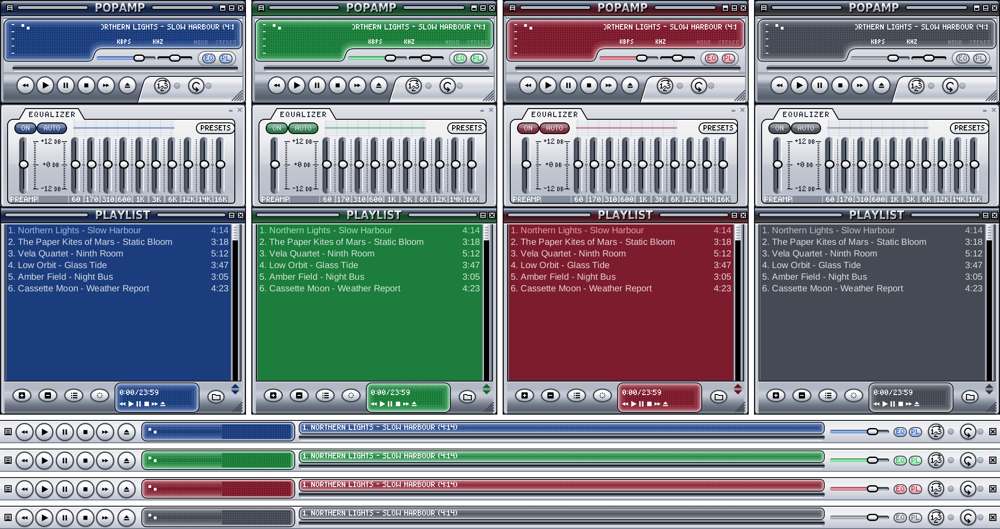

# Popamp Steel

# ⚠️ This skin was generated automatically

## It needs a designer's edits to make it simpler

The pictures were written by a program, not drawn by a designer, so the
files are more complicated than the skin needs. Fork it and redraw it.

A silver and navy skin laid out like the "modern" players of the 2000s: a dotted blue display with a segmented analyzer, round transport buttons, toggles with blue lamps, an equalizer with a dB scale, its own pixel fonts (Latin and Cyrillic) and a shade mode for all three windows.



A vector skin for [Popamp](https://github.com/popamp/popamp), skin format
version 1. All artwork is the skin's own.

## Window or bar

The main window has a second view: a bar across the screen, at its top or
bottom edge, with the main window's own buttons, toggles and volume and
two displays: the play state, time and analyzer, and the song title over
the seek groove, which stretches with the screen. Switch between the two
in the main menu's "Toolbar mode". This needs Popamp 1.0.0 or newer.

## Colours

The skin comes in four colours: Navy (as drawn), Emerald, Ruby and
Graphite. Pick one in the main menu's "Colours". A set changes the navy
of the displays, the lamps, the playlist's title bar and its list, and
keeps the silver body; Graphite keeps only a trace of blue. This needs
Popamp 1.0.0 or newer.

## Media library

The media library window has the playlist's frame, its buttons and its
display, with its own "MEDIA LIBRARY" title in the playlist's lettering.
This needs Popamp 1.0.0 or newer.

## Install

With Popamp 0.6.0 or newer from [apt.popamp.app](https://apt.popamp.app):

```sh
sudo apt install popamp-skin-steel
```

Then pick it in the main menu's skin list. Or clone it into Popamp's
skins folder, where a copy of the same name wins over the package:

```sh
git clone https://github.com/popamp/skin-steel ~/.local/share/popamp/skins/steel
```

Updating is `git pull` in that folder; Popamp reloads the skin.

## Rebuild

Everything here is generated by one script. It needs `python3-fonttools`
and `fonts-dejavu-core`:

```sh
python3 -I -B tools/gen_steel_skin.py .
```

Change the script, not the generated files.

## License

Licensed under either of [Apache License 2.0](LICENSE-APACHE) or
[MIT license](LICENSE-MIT) at your option. Labels drawn from DejaVu Sans
are outlines of a font under the DejaVu Fonts License.
