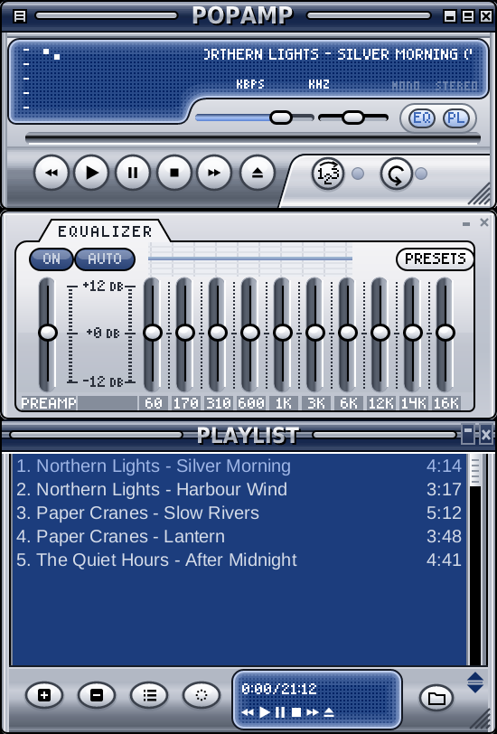

# Popamp Steel

A silver and navy skin laid out like the "modern" players of the 2000s: a dotted blue display with a segmented analyzer, round transport buttons, toggles with blue lamps, an equalizer with a dB scale, its own pixel fonts (Latin and Cyrillic) and a shade mode for all three windows.



A vector skin for [Popamp](https://github.com/popamp/popamp), skin format
version 1. All artwork is the skin's own.

## Install

Clone it into Popamp's skins folder and pick it in the main menu's skin
list:

```sh
git clone https://github.com/popamp/skin-steel ~/.local/share/popamp/skins/steel
```

Updating is `git pull` in that folder; Popamp reloads the skin.

## Rebuild

Everything here is generated by one script. It needs `python3-fonttools`
and `fonts-dejavu-core`:

```sh
python3 -I -B tools/gen_steel_skin.py .
```

Change the script, not the generated files.

## License

Licensed under either of [Apache License 2.0](LICENSE-APACHE) or
[MIT license](LICENSE-MIT) at your option. Labels drawn from DejaVu Sans
are outlines of a font under the DejaVu Fonts License.
